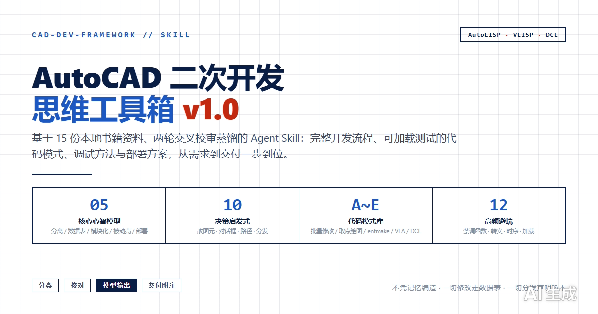

# CAD 二次开发 · 思维工具箱（cad-dev-framework）

> AutoCAD AutoLISP / VLISP / DCL 二次开发的领域方法论与工具箱。基于 15 份本地书籍资料的深度调研与两轮交叉校审，提炼为可直接落地的心智模型、决策启发式、代码模式与避坑清单。



## 这是什么

一个面向 **CAD 脚本开发** 的 Agent Skill：当你说「帮我写个改图层的程序」「这个 DCL 报错怎么解决」时，它会以一套经过交叉校审的领域共识，给出从需求到交付的完整开发流程。

核心原则只有两句：

- **先让核心逻辑跑通，再套交互壳**
- **一切修改都走数据表，一切分发都声明版本**

## 核心资产

| 资产 | 数量 | 内容 |
|------|------|------|
| 心智模型 | 5 | 界面/输入与逻辑分离、图元数据表驱动、命令入口+子函数模块化、DCL 被动壳、版本兼容与部署意识 |
| 决策启发式 | 10 | 改图元、做对话框、对话框激活期、DCL 取值、路径转义、command 用法、DCL 语法、绘图路线、选择集遍历、程序分发 |
| 代码模式库 | 5（A~E） | 遍历选择集批量修改、交互取点+polar 参数化绘图、entmake 直接建图元、VLA 对象操作、DCL 对话框标准骨架 |
| 避坑清单 | 12 | 28 个禁调函数、对话框时序、mode_tile 反直觉、路径转义、BASE.DCL 保护等高频坑 |
| 流派对比 | 3 组 | command vs entmake/ActiveX、acad.lsp 0/1、DCL 优先 vs LISP 优先 |

## Agentic Protocol（回答工作流）

```
问题分类 → 开发前核对 → 模型驱动输出 → 交付附注
(写/查错/改/咨询)  (DCL时序/28函数/转义)  (心智模型+代码模式)  (加载方式/最低版本/已知坑)
```

不凭记忆编造 CAD 函数行为——涉及具体函数、组码、版本行为时先核对知识库与官方帮助。

## 触发方式

命中以下关键词即触发：

- **CAD 二次开发**、**AutoLISP**、**VLISP**、**DCL**
- **写个 LISP 程序**、**CAD 插件**、**CAD 脚本**
- 甚至只是「帮我写个改图层的程序」「这个 DCL 报错怎么解决」

> 不触发：一般性 CAD 使用问题（绘图操作、命令行技巧）。

## 代码模式速览

```lisp
;; 模式 A · 遍历选择集批量修改字高
(defun c:cth ( / ss i en ed)
  (setq ss (ssget '((0 . "TEXT"))))
  (setq i 0)
  (repeat (sslength ss)
    (setq en (ssname ss i) ed (entget en))
    (setq ed (subst (cons 40 5.0) (assoc 40 ed) ed))
    (entmod ed)
    (setq i (1+ i)))
  (princ))
```

```lisp
;; 模式 E · DCL 对话框标准骨架（dia5a 型）
(defun dcl_dia5a ()
  (setq dcl_id (load_dialog "dia5a"))
  (new_dialog "dia5a" dcl_id)
  (set_tile "edit_p" (rtos (getvar "plinewid")))
  (action_tile "accept" "(ok_dia5a)(done_dialog 1)")
  (start_dialog)
  (unload_dialog dcl_id))
```

## 目录结构

```
cad-dev-framework/
├── SKILL.md                  # 主技能文件（本文件即为正文）
├── references/
│   └── research/             # 5 份调研文档
│       ├── 01_方法论.md
│       ├── 02_语言核心.md
│       ├── 03_DCL.md
│       ├── 04_实战模式.md
│       └── 05_坑与工具链.md
```

## 诚实边界

本 Skill 基于 R13/2000 时代书籍资料提炼，如实声明以下局限：

- 组码/系统变量未全量成体系，复杂场景需查 AutoCAD 官方帮助
- CHM 个别页标题与正文不一致，以正文为准
- 部分条目为语义推断，落地前建议对照官方帮助核实（已标注【推断】）
- 现代 CAD 版本（2004+）行为差异需实测验证

## 宣传物料

- [三页介绍 PPT](index.html)（键盘 ← → 翻页，T 换主题，S 演讲者模式）
- [宣传横幅图](banner.png)（GitHub 社交预览 1200×630）
- 页面预览图：`page1-overview.png` / `page2-models.png` / `page3-decisions.png`

## 授权

MIT License
